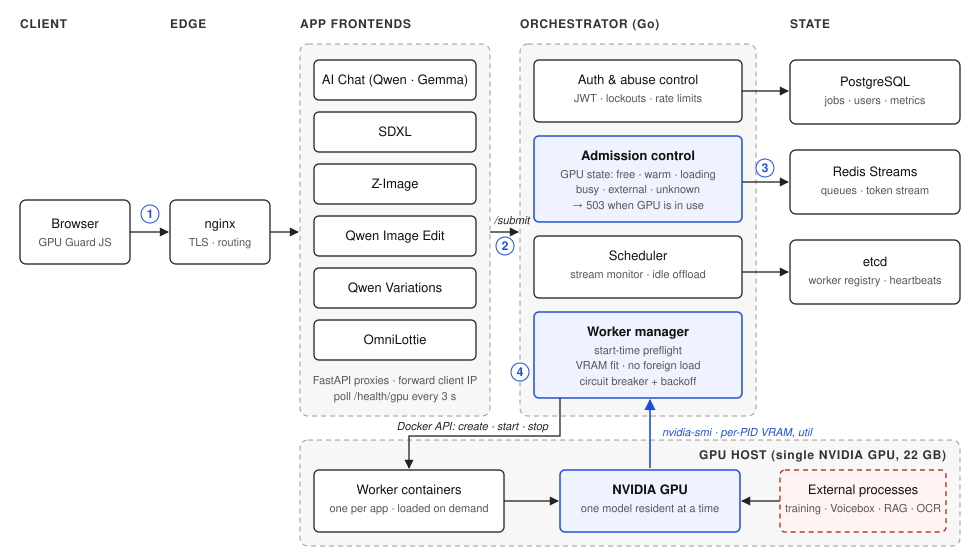
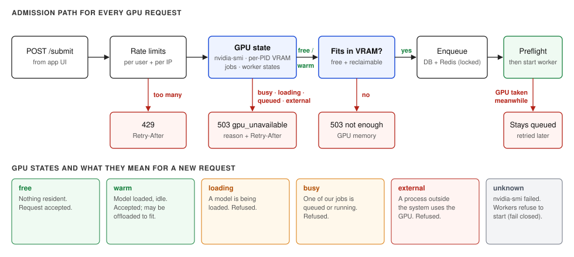

# GPU Orchestrator

**Run many large AI models on one GPU, safely.** A Go orchestrator loads one model at a time on demand, shares the GPU with whatever else runs on the machine, and refuses work while the GPU is in use, so jobs never fight for memory or crash each other.

<p align="center">
  
</p>

<p align="center"><sub><b>Figure 1.</b> System architecture. Requests flow (1) browser to nginx, (2) app UI to the orchestrator, (3) through admission control into a per-app Redis queue, and (4) to a worker container started on demand. Blue blocks are the components that decide whether the GPU may be used; the orchestrator senses the GPU with <code>nvidia-smi</code> and attributes memory to its own workers or to external processes.</sub></p>

---

## Why this exists

A single 22 GB GPU cannot hold an SDXL pipeline, a 27B chat model and an image editor at once, and other people on the same machine also run training jobs and services on it. Naive setups either keep everything loaded (out of memory) or start models blindly (crashes and corrupted runs). This project makes the GPU a **managed, shared resource**:

- **One model resident at a time**, loaded on demand and offloaded after an idle timeout.
- **Honest GPU status**: it distinguishes *our* usage from *someone else's* using per-process VRAM attribution, not just a utilisation number.
- **Hard admission control**: if the GPU is in use, new requests are refused with a clear reason, and workers refuse to start.
- **The same rule everywhere**: every app UI, the portal and the other GPU services read one GPU status and pause together.

## Highlights

| Area | What you get |
|---|---|
| Scheduling | Per-app Redis Streams queues, on-demand worker containers, idle offload, warm-model reuse |
| GPU awareness | `free / warm / loading / busy / external / unknown` state, per-PID VRAM split (ours vs external) |
| Admission control | `503` + `Retry-After` while the GPU is in use; atomic check-and-enqueue; VRAM-fit check per model |
| Start-time safety | Workers never start onto a busy GPU (automatic *and* admin paths), fail-closed if the GPU cannot be read, circuit breaker with backoff |
| Abuse protection | Per-account login lockout, per-IP and per-user rate limits, signup throttling, body-size caps, constant-time admin key check |
| UI | Seven app UIs with a shared GPU guard (status badge, banner, blocked submit), dark mode, phone layouts |
| Ops | Admin dashboard, job history, metrics, orphan-job cleanup, Go unit tests |

## Admission control

<p align="center">
  
</p>

<p align="center"><sub><b>Figure 2.</b> The path every GPU request takes. The check and the job insert happen under one lock, so two simultaneous requests cannot both be admitted. The same state machine gates worker start-up, so a model is never loaded onto a GPU that is in use.</sub></p>

### GPU states

| State | Meaning | New request |
|---|---|---|
| `free` | Nothing resident, no foreign load | Accepted |
| `warm` | One of our models is loaded and idle | Accepted (may be offloaded to make room) |
| `loading` | A worker is starting or loading a model | Refused |
| `busy` | One of our jobs is queued or running | Refused |
| `external` | A process outside the orchestrator is using the GPU | Refused |
| `unknown` | `nvidia-smi` could not be read | Workers refuse to start (fail closed) |

`GET /health/gpu` returns the full picture, including `is_available`, a human-readable `message`, VRAM split into `orchestrator_vram_gb` and `external_vram_gb`, and the list of GPU processes.

```json
{
  "state": "external",
  "is_available": false,
  "message": "GPU in use by another process (98% load, 11.5 GB)",
  "free_vram_gb": 10.48,
  "orchestrator_vram_gb": 0,
  "external_vram_gb": 11.54,
  "retry_after_seconds": 30
}
```

## Services

| Service | Port | Description |
|---|---|---|
| Orchestrator | 8890 | Job routing, admission control, worker lifecycle |
| Main dashboard | 8810 | Service hub |
| Admin dashboard | 8811 | Workers, metrics, jobs (login required) |
| SDXL UI | 8861 | Stable Diffusion XL image generation |
| Z-Image UI | 8862 | Z-Image Turbo generation |
| Qwen Image Edit UI | 8865 | Edit images with natural language |
| Qwen Image Variations UI | 8866 | Random style variations |
| AI Chat UI | 8867 | Streaming chat with Qwen 3.5 and Gemma 4 |
| OmniLottie UI | 8868 | Text / image / video to Lottie animation |

Every app UI includes `frontend/shared/gpu-guard.js`: it polls the GPU status, shows a banner, and blocks submit buttons (including Enter-to-send) while the GPU is unavailable. It reports *offline*, never *free*, if the orchestrator cannot be reached.

## Quick start

**Prerequisites:** Docker with Compose, an NVIDIA GPU with drivers, and the NVIDIA Container Toolkit.

```bash
# 1. Backend
cd backend
cp ../.env.example .env        # then set the secrets below
docker compose up -d postgres redis etcd orchestrator
docker compose ps

# 2. Frontends
cd ../frontend
cp ../backend/.env .env        # the admin dashboard needs ADMIN_API_KEY
docker compose up -d --build
```

Workers (one per model) are **not** started by Compose; the orchestrator starts and stops them on demand. Open the hub at `http://localhost:8810`.

### Configuration (`backend/.env`)

```bash
POSTGRES_PASSWORD=change-me
JWT_SECRET=$(openssl rand -hex 32)
ADMIN_API_KEY=$(openssl rand -hex 24)   # required for /admin/*; sent as X-Admin-Key
HF_TOKEN=your_huggingface_token
```

> `ADMIN_API_KEY` and `JWT_SECRET` should always be set. With an empty admin key the admin API is unprotected.

Models and their VRAM budgets live in `backend/config/apps.yaml`; the scheduler uses `gpu_vram_gb` for the fit check.

## Security and abuse controls

- **Brute force:** an account locks for 15 minutes after 5 failed logins; an IP after 20; repeated wrong admin keys lock that IP. Unknown accounts take the same time as wrong passwords.
- **Spam:** limits per user and per IP on submissions, signups and overall requests; request bodies are size-capped; slow-header attacks are cut off.
- **Client IPs:** forwarded addresses (`X-Forwarded-For`) are trusted only from loopback and private/docker networks, so LAN clients cannot spoof their way around limits.
- **Network:** Postgres, Redis and etcd are bound to localhost and the Docker bridge only.

## API

| Endpoint | Auth | Purpose |
|---|---|---|
| `POST /submit` | optional JWT | Submit a job (`503` when the GPU is in use) |
| `GET /status/{job_id}` | none | Job status and result |
| `GET /health/gpu` | none | GPU state (see above) |
| `GET /workers` | none | Registered workers |
| `POST /auth/signup`, `/auth/login`, `GET /auth/me` | none / JWT | Accounts |
| `GET /user/jobs`, `/user/jobs/{id}` | JWT | Job history |
| `/admin/*` | `X-Admin-Key` | Jobs, worker actions, metrics, config |

## Testing

```bash
cd backend/orchestrator
go vet ./... && go test ./...
```

Unit tests cover the GPU state decision, VRAM-fit logic, rate limiting, failure lockouts and client-IP spoofing resistance.

## Operations

```bash
curl localhost:8890/health/gpu        # GPU state and VRAM split
curl localhost:8890/workers           # registered workers
docker logs gpu-orchestrator          # orchestrator log
bash scripts/cleanup_orphaned_gpu.sh  # GPU not freed after a container stop
```

A job that no live worker owns is failed automatically after 15 minutes; jobs a worker is still handling are never touched.

## Project layout

```
.
├── backend/
│   ├── orchestrator/        # Go: API, admission control, worker manager, rate limits
│   │   ├── gpu_state.go     #   GPU state machine + start-time preflight
│   │   ├── ratelimit.go     #   limiters, lockouts, client-IP trust rules
│   │   └── worker_manager.go
│   ├── worker/              # one container per model (+ shared proto, GPU lock)
│   ├── config/              # apps.yaml (registry), workers.yaml
│   └── docker-compose.yml
├── frontend/
│   ├── shared/gpu-guard.js  # shared GPU status + submit blocking
│   └── …-ui/                # one FastAPI UI per app, admin and main dashboards
├── scripts/                 # ops helpers
└── assets/                  # figures (SVG + PNG)
```

## Adding a model

```bash
./create_worker.sh my-model
# implement handler.py, register it in config/apps.yaml (set gpu_vram_gb)
```

See [ADDING_NEW_APPS.md](ADDING_NEW_APPS.md). The design write-up is in [GPU Polling: Self-Managing GPU Orchestration.md](GPU%20Polling:%20Self-Managing%20GPU%20Orchestration.md).

## Limitations

- One GPU is managed; multi-GPU scheduling is not implemented.
- External-process detection relies on `nvidia-smi`; a process using the GPU that is idle (no load) is counted as held VRAM, not as busy.
- Services outside the orchestrator (for example Voicebox) are paused in the portal but are not blocked at the application level unless they apply the same gate.
